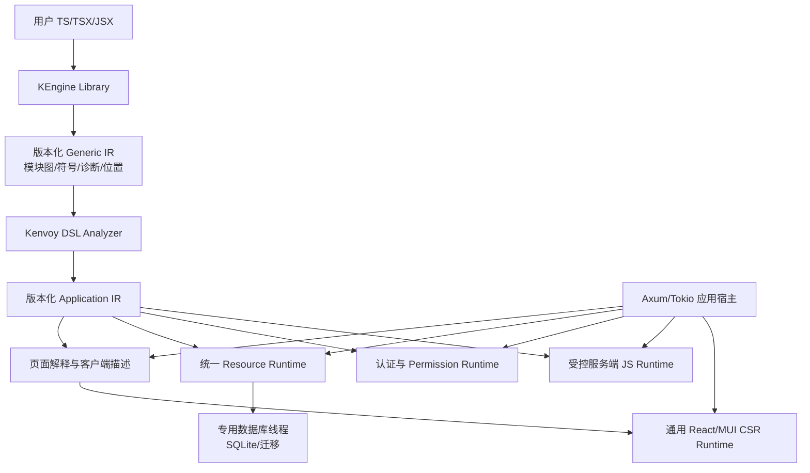

# KEngine + Kenvoy 架构与现状

状态：现行；核对日期：2026-11-01。本篇提供架构总览，模块细节从[文档索引](README.md)进入，完成范围见[阶段状态](development-roadmap.md)。

## 当前实现范围

KEngine 理解 JavaScript、TypeScript、JSX、TSX 的通用语言结构；Kenvoy 将声明解释为可运行应用。第一版采用 React + MUI + CSR、Axum + Tokio、SQLite + rusqlite 和受限 JavaScript 执行，客户应用的真实数据闭环已完成验收。

已实现通用 KEngine、业务 DSL、Application IR、真实 SQLite、迁移、HTTP、认证、React/MUI 前台及后台、自定义组件与受限 JavaScript Runtime。七个 CLI 命令、版本化产物、原生文件监听和 Vite 开发适配已接入；各项验收状态以最新验证记录为准。

## 组件与职责

图中只有 KEngine 属于 `kengine`；其余解释、构建、数据库、UI、权限与服务均属于 `kenvoy`。前端资产可以在 Binary Crate 内或仓库非 Rust 目录维护，不能为此新建第三个 Rust Crate。

| 层次 | 当前实现 | 详细契约 |
|---|---|---|
| 通用语言引擎 | SWC 解析、Generic IR、作用域、链接和增量会话 | [KEngine 设计](kengine-design.md)、[API](kengine-api.md) |
| 业务解释 | 静态 DSL、Application IR、页面/资源/动作/权限 | [Kenvoy 设计](kenvoy-design.md)、[解释器分工](interpreter-design.md) |
| 应用宿主 | Axum、SQLite worker、Session、受限 QuickJS | [运行时](runtime-design.md)、[数据库](database-design.md)、[安全](security-design.md) |
| 浏览器与构建 | 通用 React Runtime、自定义组件、版本化产物与开发适配 | [前端](frontend-runtime.md)、[CLI](cli-design.md) |

## 两层模型

Generic IR 表示“存在 JSX 标签、属性、表达式和引用”，保留动态表达式，不理解表和路由。Application IR 表示“资源、字段、页面、操作和权限”。两者分别版本化，转换方向只能是 Generic IR → Application IR。

页面、API、数据库和管理后台使用同一份经验证 Application IR。浏览器得到最小客户端投影，不能拿到服务端模块、私有配置或整份内部执行计划。需要构建时完成源码解析；已有有效产物可直接加载，HTTP 请求只访问已发布快照。

## 生命周期与一致性

需要构建或更新时，管线是项目发现 → 严格配置校验 → 语言分析 → DSL 分析 → 候选 IR → Schema Diff → 资产与服务端模块准备 → 允许的迁移 → 发布运行快照。使用有效产物启动时，直接加载并校验应用描述、资产与服务端模块，再检查数据库状态并初始化运行时，不依赖源码解析。dev 和 run 共享模型、权限、数据库路径与 API 语义；dev 另有文件监听和更新通知。

一次更新以 generation 标识 IR、路由、客户端注册表和服务端模块。候选先解析、校验、构建并封存，运行态持写锁执行安全迁移后同步切换模型、资产和 JavaScript；接受的发布任务不会因调用者取消而中断。完成后才激活磁盘 manifest。构建/迁移失败保留旧模型与清单；提交后开发适配失败回退已验证静态产物并明确报告，不声称数据库已经回滚。详见 [运行时设计](runtime-design.md)。

## 验收与后续边界

阶段 00—10 的第一版基础验收已完成，实际命令、计数及二进制范围见[最终验收](verification/0012-final-acceptance.md)。这一结论限于记录中的 Windows 环境和场景；跨平台、长时负载、故障注入及可选扩展见[技术风险](technical-risks.md)，不据此宣称全部生产发布工作完成。

## 历史基线（参考）

初始审查针对 `main` 的 `b381cba`，当时工作区干净，两个包只是空骨架：Workspace 使用 `crates/*`，尚无解析器、应用依赖或测试，锁文件只有两个本地包。原始验证事实保存在[阶段 00 报告](verification-report.md)，技术选型过程见[探针记录](verification/0001-stage00-probes.md)。

此前 `0a84400` 的 XML、业务化 KEngine、SSR/PostgreSQL 及额外 Crate 路线已在该基线退出，没有作为当前实现恢复。原先可借鉴的版本化模型、路径保护和资源释放原则分别落实到现有模块；历史能力不计入当前验收。

当前明确列出两个 Workspace 成员，Kenvoy 通过公共 API 单向依赖 KEngine，Rust/npm 依赖均有锁文件。初始空骨架的描述只用于追溯，不表示现有工程仍处于该状态。
