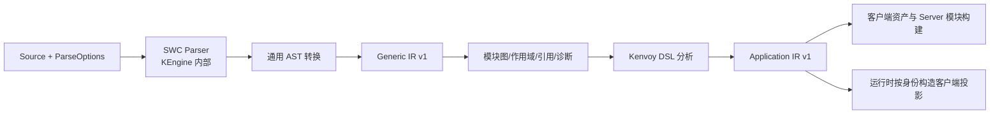

# 编译管线与通用解析设计

状态：参考（现状文档）。本篇解释编译管线与职责分配；精确调用契约见 [KEngine API](../contracts/kengine-api.md)，序列化类型见 [Generic IR](../contracts/generic-ir.md)。并行解析、跨进程缓存及完整 npm/tsconfig 解析尚未实现。

## 管线和所有权

KEngine 负责 Source 到通用分析结果；Kenvoy 负责 DSL 之后的业务处理，以及 TS→JS 转换、目标环境打包和执行。SWC AST 是内部实现，不成为长期公共 API。相关依赖按实际兼容关系成组锁定，版本见[技术栈](../reference/technology-stack.md)。

## 调用边界与结果所有权

Engine 为无状态入口：parse_source/parse_file 返回 ParseOutput，analyze_project 返回 ProgramIR；模块图和诊断由结果对象持有，不保存进程级“最后一次分析”。需要跨次更新时，由调用方持有 AnalysisSession 并取得 AnalysisUpdate。

ParseOptions 控制语言，AnalyzeOptions 控制入口、解析和模块解析选项。项目根与入口由调用者提供，KEngine 不发现 Kenvoy 项目、不读取 kenvoy.toml。具体参数、返回类型和访问方法统一维护在[公共 API](../contracts/kengine-api.md)。

解析成功仍可能含恢复错误。KEngine 收集 fatal 和 recovered diagnostics；Kenvoy 只接受无阻断诊断的模块。I/O 和内部不可恢复错误使用 thiserror 类型保留 source；语法和语义问题以结构化 Diagnostic 返回，不能把错误全部压成字符串。

## Generic IR v1

ProgramIR 汇集模块、模块图、绑定与诊断；ModuleIR 保留源码、节点、表达式及模块内语义。IR 独立版本化，不将 SWC 内部枚举作为协议。节点 ID 用于当前分析快照定位，不承诺跨源码变更稳定；业务资源身份由 Kenvoy 单独定义。

属性不能统一字符串化。字符串、数字、布尔、null 与表达式引用区分；例如函数属性保留表达式 ID，并结合语义和模块绑定定位引用，不转换成 JSON 函数。spread 保留原顺序与源表达式，不能错误合并覆盖。

未知动态表达式至少保留源文件、源码区间、表达式类型、被引用符号和模块关联；可以增加结构化子树。保留引用不意味着 KEngine 会执行表达式。序列化结果不依赖 SWC 内部枚举格式；源码包及引用可在工具侧关联，Kenvoy 客户端投影不得直接发布原始源码片段。

## 模块解析

相对路径从 importer 目录解析，依次核对精确文件、允许的 JS→TS 映射、源码扩展与目录 index；`.diu` 说明符可追加 `.tsx`。结果经 canonicalize 去重并检查项目根边界，防止重复模块身份或越界读取。

tsconfig paths/baseUrl 和 package exports/conditions 是独立能力，不等于完整 TypeScript 编译器。第一阶段只实现并声明支持子集；遇到未支持的路径映射或条件不能静默猜测。外部 npm 包可在图中记录为 External，前端适配器用实际构建器完成包解析；不得把“外部依赖已记录”称作“依赖已验证可用”。Schema 静态展开和服务端执行所需依赖必须可确定解析，否则阻止构建。

模块图处理静态 import、re-export 及 type-only 关系。动态表达式保留在 IR 中，不等于已经求解动态依赖；Kenvoy 的执行和客户端边界另作严格检查。已访问集合和强连通分量处理循环；一般 ESM 环可记录，静态 Schema 展开环则由 Kenvoy 报错。

## 作用域和符号

区分 module、function、block、class 作用域及 shadowing；为导入别名、函数/变量/类、JSX 组件引用和函数调用建立关联。区分 JS 值空间与 TS 类型空间，保留未解析引用，不声称完整类型检查或全局变量校验。

重导出沿图定位到实际声明。Kenvoy 用该结果定位 Schema 组件和 action handler；不能通过字符串相同就认定函数或组件身份。

## 位置和诊断

内部起止字节区间采用左闭右开；对用户行、列从 1 开始，列按 Unicode 字符计数；与 SWC 原始字节位置和未来 sourcemap UTF-16 列的转换需显式处理。测试中文、emoji、CRLF 和空行，不能用字节列冒充可见列。

Diagnostic 包含 code、category、severity、path、可选 span、message、suggestion 和 related。KEngine 诊断码使用 KE 前缀，Kenvoy 业务诊断使用 KV 前缀；已登记代码见[公共 API](../contracts/kengine-api.md)。无源码位置的读取/配置错误保留上下文，不伪造行列。

## 缓存与增量

当前 AnalysisSession 缓存按规范路径、完整源码内容和 ParseOptions 比较，避免仅依赖 mtime 或散列碰撞。进程内使用当前 IR 版本，不缓存跨版本结果。变更重新解析该模块，复用未变模块和诊断；依赖定位、图/SCC、跨模块链接重算，以处理未改 importer 时目标文件新增/删除及 resolver 选项变化。affected 记录新旧图的反向依赖闭包。

当前缓存由会话拥有，移出项目的模块被移除，clear 释放会话状态。增量结果与全量结果已有对照测试。并行解析及跨进程缓存属于后续方向；引入时还需验证确定性合并、失效规则及资源上限。

## 验收

阶段 01 验证四种语法、真实 TSX、嵌套、Fragment、spread、函数属性、泛型、导入导出、错误位置。阶段 02 加入 shadowing、循环依赖、重导出、路径解析、未知表达式保留、序列化版本和增量等价性。

公开 API、通用结构和实际消费示例在 [engine_api.rs](../../crates/kengine/tests/engine_api.rs)及 [engine_boundary.rs](../../crates/kenvoy/tests/engine_boundary.rs)编译运行。阶段 02 新增语义、表达式、模块链接及增量对照测试；实际覆盖与未建模语法以 [API](../contracts/kengine-api.md)为准，不宣称完整 TS 类型检查。相关设计：[DSL](dsl-design.md)、[边界](crate-boundaries.md)、[ADR 0003](../decisions/0003-generic-ir-design.md)。
