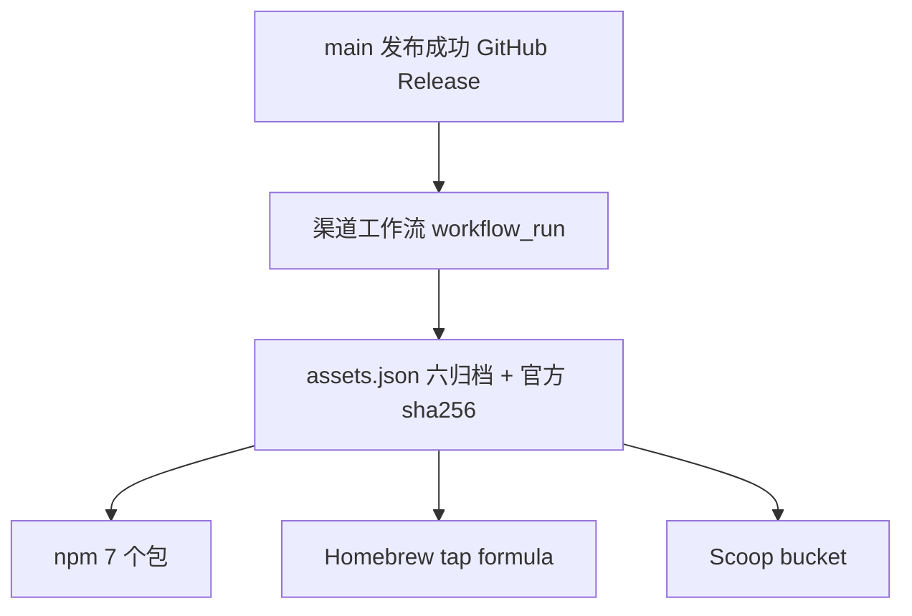

# 多渠道软件包发布

状态：参考；治理：现状文档。适用范围：Kenvoy CLI 二进制分发到 npm、Homebrew、Scoop。crates.io 与 GitHub Release 继续沿用 [Git 与发布操作](releasing.md)；渠道收敛及专用凭据清理见 [0032](../changes/0032-retire-linux-and-winget-channels.md)，当前前置条件见[渠道进度](../development/channel-rollout-status.md)。以下安装命令仅供正式发布后使用，不表示现在已经上线。

## 总体结构



渠道工作流为 [.github/workflows/channels.yml](../../.github/workflows/channels.yml)：由 `main 最新版本自动发布` 成功结束触发，也支持 `workflow_dispatch` 指定已发布版本补发。`prepare` 在任何 Secret 消费前检查当前 ref、来源分支和来源仓库，拒绝 dev、tag 与外仓事件；后续 job 固定检出 `prepare` 确认的源码提交，不混用运行期间变化的 main。它只消费已存在的 GitHub Release 资产，不重新编译、不改动 crate 或 Release。每个渠道独立 job，单渠道失败不撤销已经完成的 Release。

前置条件：版本 tag 已推送；对应正式 Release 已发布、非 draft/prerelease，六个 ZIP 均带 GitHub 官方 digest。下载和复用缓存都核对 SHA-256，不覆盖损坏缓存。缺归档或摘要不符时停止，不进入各渠道。0.2.0 及更早的 Release 使用旧的三元组文件名，不在自动发现兼容范围内；渠道发布从采用 `kenvoy-{version}-{platform}-{arch}.zip` 的版本开始。

源码发布仍执行现有完整 Git 树一致性门禁：首次发布源码时，main 的树必须与该版本 tag 一致。标签之后仅修改文档或渠道配置，也不能跳过这项检查。本次经用户确认采用 CLI 0.4.2 的最终版本提交与新本地标签；不移动旧 tag，也不自动推送。

## 资产与命名

`assets.json` 由 [assets.py](../../.github/scripts/channels/assets.py) 生成，固定六项：`windows/linux/macos × x86_64/ARM64`，文件名 `kenvoy-{version}-{platform}-{arch}.zip`，`sha256` 取 Release 资产 digest。所有渠道只引用这些官方归档，不各自重算二进制。

## npm

发布 7 个**无 scope** 包，避免依赖 npm 组织：

| 包 | 内容 |
|---|---|
| `kenvoy` | 主包：`bin` 为 JS shim，按 `process.platform/arch` 解析平台包，转发参数、stdio 与退出码 |
| `kenvoy-win32-x64`、`kenvoy-win32-arm64` | Windows 二进制 |
| `kenvoy-linux-x64`、`kenvoy-linux-arm64` | Linux musl 静态二进制 |
| `kenvoy-darwin-x64`、`kenvoy-darwin-arm64` | macOS 通用归档中的对应架构 |

主包通过 `optionalDependencies` 依赖六个平台包；平台包声明 `os`/`cpu`，内含真实 `bin/kenvoy(.exe)`。七个包都附带官方归档中的原始 `LICENSE`。

[publish_npm.py](../../.github/scripts/channels/publish_npm.py) 默认只读预检：先校验全部包，再查询全部版本；仅精确 HTTP 404 表示尚未发布，鉴权、限流、网络及服务端异常均失败。显式 `--publish` 且处于 main 才写入，先发布六个平台包、最后发布主包；已有版本跳过，首次失败即停止，不盲目重试或覆盖版本。实际命令保留 `--access public --provenance --ignore-scripts`。

### npm 鉴权与首次接入

- 长期使用 Trusted Publishing（OIDC）：GitHub-hosted runner、`id-token: write`、npm ≥ 11.5.1、Node ≥ 22.14；绑定仓库 `zerobiubiu/kenvoy` 和工作流文件 `channels.yml`，包的 `repository.url` 须对应本仓库。现有工作流让 npm 自行选择 OIDC，缺少 `NPM_TOKEN` 不会提前阻断有效的可信发布。
- 首次创建包与建立绑定是独立前提。七个包尚不存在时，不能声称仅配置 OIDC 就已可发布；首发需由拥有包名权限的账号通过受允许的交互 2FA 或 Granular token 完成。每个包建立 Trusted Publisher 后再撤掉临时 Token。
- 不再创建旧式 Automation token。npm 自 2025 年 11 月起仅支持 Granular token；其绕过 2FA 的直接发布方式将于 2027 年 1 月退役。不得绕过账号或组织的强制 2FA 要求。
- 自 2026 年 9 月起，新可信发布配置还须明确允许工作流执行 `npm publish`，不能只启用 staging。新绑定两天内未首次发布会失效，应在实际发布窗口配置，而非长期提前占位。
- `npm whoami`/`npm view` 不能证明 OIDC 已获发布授权；以真实受授权发布及安装结果验收。

依据：[Access tokens](https://docs.npmjs.com/about-access-tokens/)、[Trusted publishers](https://docs.npmjs.com/trusted-publishers/)（2026-11-04 核对）。

安装：

```text
npm install -g kenvoy
kenvoy --version
```

## Homebrew

tap 仓库 `zerobiubiu/homebrew-tap`，formula 为二进制形式，按 `on_macos/on_linux` 与 `on_arm/on_intel` 选择 Release ZIP，`bin.install "kenvoy"`。不使用源码构建或 bottle 重建。

```text
brew tap zerobiubiu/tap
brew install kenvoy
```

## Scoop

bucket 仓库 `zerobiubiu/scoop-bucket`，清单 `bucket/kenvoy.json` 提供 64bit/arm64 的 URL、hash、`bin: kenvoy.exe`、`checkver`/`autoupdate`。

```text
scoop bucket add zerobiubiu https://github.com/zerobiubiu/scoop-bucket
scoop install kenvoy
```

## 所需仓库 Secret

| Secret | 用途 | 生成方式 |
|---|---|---|
| `NPM_TOKEN` | 首次接入时的过渡发布凭据；配置有效 OIDC 后可省略 | 获准发布七个包的 Granular token；不能使用已退役 Automation token |
| `PACKAGES_TOKEN` | 推送 Homebrew tap 与 Scoop bucket | 对 `homebrew-tap`、`scoop-bucket` 有写权限的 GitHub 凭据 |

除 npm 可选择有效 OIDC 外，各 job 缺少必要 Secret 时明确失败，不伪造成功。所有密钥只在对应 job 注入，不打印、不写入发布制品。复用现有 GitHub 登录凭据须获得授权；它的权限可能大于渠道所需权限，后续改为专用最小权限凭据时应单独验证，不擅自撤销现有登录。

### 配置步骤（Windows / Git Bash）

凭据经 `gh secret set` 的交互输入或标准输入直接写入仓库，不经过聊天、源码、命令参数或输出。先查现有配置，不盲目覆盖；本轮完成项与缺口只在[渠道进度](../development/channel-rollout-status.md)维护。

```bash
# npm：先按上文确认 Granular token 与首发策略
gh secret set NPM_TOKEN --repo zerobiubiu/kenvoy

# 只列名称与更新时间，不能据此读取或证明 Secret 的值
gh secret list --repo zerobiubiu/kenvoy
```

APT、RPM、Alpine、Arch、WinGet、Chocolatey 与 AUR 均已退役，不再配置专用签名、索引、SSH 或 PR 凭据。`WINGET_TOKEN`、`GPG_PRIVATE_KEY`、`GPG_PASSPHRASE`、`APK_SIGNING_KEY` 已按授权删除；`CARGO_TOKEN` 仍由主发布流程使用。旧 `kenvoy-packages` 仓库和本地恢复副本保留，但不是有效安装源。

## 验证边界

当前验证范围为保留渠道的单元回归、真实归档生成、删除前后产物逐字节对照、npm 封装运行和工作流检查，证据见 [0032](../changes/0032-retire-linux-and-winget-channels.md#执行验证记录)。旧 Linux 仓库与 WinGet 的验证只保留在历史记录中，不属于现行发布范围。未运行远端工作流或真实渠道安装；不能把 Secret 配置和本地生成当成已上线。
