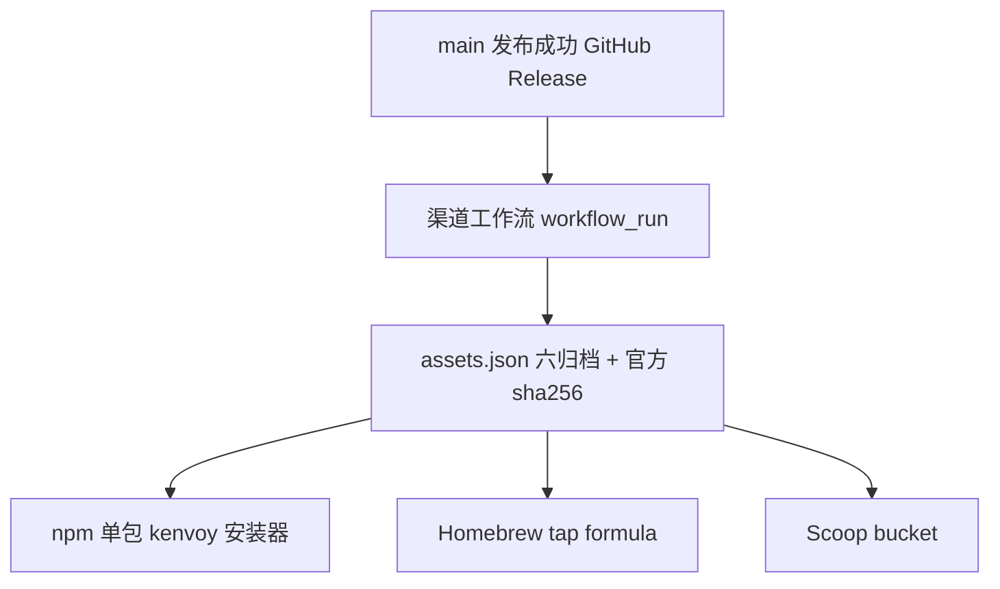

# 多渠道软件包发布

状态：参考；治理：现状文档。适用范围：Kenvoy CLI 二进制分发到 npm、Homebrew、Scoop。crates.io 与 GitHub Release 继续沿用 [Git 与发布操作](releasing.md)；渠道退役见 [0032](../changes/0032-retire-linux-and-winget-channels.md)，npm 单包切换与首发见 [0033](../changes/0033-single-npm-package-download.md)，实际进度见[渠道进度](../development/channel-rollout-status.md)。安装命令不代表尚未发布版本已上线。

## 总体结构



渠道工作流为 [.github/workflows/channels.yml](../../.github/workflows/channels.yml)：由 `main 最新版本自动发布` 成功结束触发，也支持 `workflow_dispatch` 指定已发布版本补发。`prepare` 在任何 Secret 消费前检查当前 ref、来源分支和来源仓库，拒绝 dev、tag 与外仓事件；后续 job 固定检出 `prepare` 确认的源码提交，不混用运行期间变化的 main。它只消费已存在的 GitHub Release 资产，不重新编译、不改动 crate 或 Release。每个渠道独立 job，单渠道失败不撤销已经完成的 Release。

前置条件：版本 tag 已推送；对应正式 Release 已发布、非 draft/prerelease，六个 ZIP 均带 GitHub 官方 digest。下载和复用缓存都核对 SHA-256，不覆盖损坏缓存。缺归档或摘要不符时停止，不进入各渠道。0.2.0 及更早的 Release 使用旧的三元组文件名，不在自动发现兼容范围内；渠道发布从采用 `kenvoy-{version}-{platform}-{arch}.zip` 的版本开始。

源码发布仍执行完整 Git 树一致性门禁：首次发布源码时，main 的树必须与该版本 tag 一致。标签之后仅修改文档或渠道配置，也不能跳过检查。0.4.3 因 Cargo 凭据变量错误在上传前失败，经用户确认修复后改发 0.4.4；保留所有旧标签，先推新标签再同步 main，不放宽门禁。恢复事实见 [0034](../changes/0034-cargo-auth-and-044-release.md)。

## 资产与命名

`assets.json` 由 [assets.py](../../.github/scripts/channels/assets.py) 生成，固定六项：`windows/linux/macos × x86_64/ARM64`，文件名 `kenvoy-{version}-{platform}-{arch}.zip`，`sha256` 取 Release 资产 digest。所有渠道只引用这些官方归档，不各自重算二进制。

## npm

只发布一个无 scope 包 **`kenvoy`**，不生成、发布或依赖 `kenvoy-win32-*`、`kenvoy-linux-*`、`kenvoy-darwin-*` 平台分包。

包内包含 `postinstall` 安装器、命令入口、六目标 `download-manifest.json` 和原始 LICENSE。安装时按 `process.platform` / `process.arch` 选择 Windows、Linux、macOS 的 x64/arm64，网络上只下载当前平台的正式 Release ZIP；不要求用户安装 Rust 或外部解压工具。

生成器先核对六份发行 ZIP 的官方摘要，再固化每项的真实 URL、归档长度/摘要、唯一可执行成员及其长度/摘要。安装器依次验证 ZIP 和程序，才原子写入包内 `vendor/<binarySha256>/kenvoy(.exe)`；旧摘要缓存不能充当新程序的回退。合法的已有文件可直接复用，Unix 执行权限为 0755。

运行入口只执行已安装程序并保留参数、stdio 与退出结果，不再联网补装。若使用 `--ignore-scripts` 跳过安装，局部依赖可执行 `npm rebuild kenvoy`，全局安装执行 `npm rebuild -g kenvoy`。npm 12 默认还会拦截未授权的依赖脚本：局部项目须先通过 `npm install-scripts approve kenvoy` 审批，全局安装/重建才使用 `--allow-scripts=kenvoy`。不能把 npm install 的退出码 0 当成二进制已安装。

下载遵循 npm/HTTP(S) 代理及 NO_PROXY，保留 TLS 校验；仅接受官方 GitHub HTTPS 地址及有限的官方 CDN 跳转。下载中断、长度/摘要错误、非法或重复 ZIP 成员都使安装失败，不留下可运行的半成品。ZIP 与代理库只是通用 JavaScript 依赖，不是 Kenvoy 平台分包；版本来源见[技术栈](../reference/technology-stack.md)。

[publish_npm.py](../../.github/scripts/channels/publish_npm.py) 使用 `--package <kenvoy目录>`，默认只读预检；仅精确 HTTP 404 表示该版本未发布，鉴权、限流、网络及服务端异常均失败。CI 中显式 `--publish` 且处于 main 才上传这个包；已有版本跳过，不盲目重试或覆盖。`--ignore-scripts` 只作用于发布操作，不会取消用户安装时的 postinstall。

### npm 鉴权与首次接入

- 长期使用 Trusted Publishing（OIDC）：GitHub-hosted runner、`id-token: write`、npm ≥ 11.5.1、Node ≥ 22.14；绑定仓库 `zerobiubiu/kenvoy` 和工作流文件 `channels.yml`，包的 `repository.url` 须对应本仓库。现有工作流让 npm 自行选择 OIDC，缺少 `NPM_TOKEN` 不会提前阻断有效的可信发布。
- 首次创建包与 OIDC 绑定是独立前提。手动首发须得到明确授权，使用已验证的正式归档及 npm 账号要求的 2FA。现在只需给 `kenvoy` 配置一个 Trusted Publisher，不再有六个平台包的绑定；本地手动发布不伪造 main 上下文或 CI provenance。
- 不再创建旧式 Automation token。npm 自 2025 年 11 月起仅支持 Granular token；其绕过 2FA 的直接发布方式将于 2027 年 1 月退役。不得绕过账号或组织的强制 2FA 要求。
- 自 2026 年 9 月起，新可信发布配置还须明确允许工作流执行 `npm publish`，不能只启用 staging。新绑定两天内未首次发布会失效，应在实际发布窗口配置，而非长期提前占位。
- `npm whoami`/`npm view` 不能证明 OIDC 已获发布授权；以真实受授权发布及安装结果验收。

依据：[Access tokens](https://docs.npmjs.com/about-access-tokens/)、[Trusted publishers](https://docs.npmjs.com/trusted-publishers/)。OIDC 字段使用 GitHub 用户 `zerobiubiu`、仓库 `kenvoy`、工作流文件名 `channels.yml`；当前 job 未配置 environment，可留空。必须允许直接 `npm publish`，只允许 staging 不足以执行现有 CI。账号与 OIDC 由用户自行配置，不在聊天中提交密码、验证码或 Token。

安装（npm 12 只授权本包，不全局放行依赖脚本）：

```text
npm install -g kenvoy --allow-scripts=kenvoy
kenvoy --version
```

局部项目也可先执行 `npm install-scripts approve kenvoy`，再执行 rebuild；该审批命令不支持全局模式。依据：[npm install-scripts](https://docs.npmjs.com/cli/v12/commands/npm-install-scripts/)。

## Homebrew

tap 仓库 `zerobiubiu/homebrew-tap`，formula 为二进制形式，按 `on_macos/on_linux` 与 `on_arm/on_intel` 选择 Release ZIP，`bin.install "kenvoy"`。不使用源码构建或 bottle 重建。

```text
brew tap zerobiubiu/tap
brew install kenvoy
```

## Scoop

bucket 仓库 `zerobiubiu/scoop-bucket`，清单 `bucket/kenvoy.json` 提供 64bit/arm64 的 URL、hash、`bin: kenvoy.exe`、`checkver`/`autoupdate`。

```text
scoop bucket add zerobiubiu https://github.com/zerobiubiu/scoop-bucket
scoop install kenvoy
```

## 所需仓库 Secret

| Secret | 用途 | 生成方式 |
|---|---|---|
| `NPM_TOKEN` | 未采用有效 OIDC 时的过渡发布凭据 | 获准发布 `kenvoy` 的 Granular token；不能使用已退役 Automation token |
| `PACKAGES_TOKEN` | 推送 Homebrew tap 与 Scoop bucket | 对 `homebrew-tap`、`scoop-bucket` 有写权限的 GitHub 凭据 |

除 npm 可选择有效 OIDC 外，各 job 缺少必要 Secret 时明确失败，不伪造成功。所有密钥只在对应 job 注入，不打印、不写入发布制品。复用现有 GitHub 登录凭据须获得授权；它的权限可能大于渠道所需权限，后续改为专用最小权限凭据时应单独验证，不擅自撤销现有登录。

### 配置步骤（Windows / Git Bash）

凭据经 `gh secret set` 的交互输入或标准输入直接写入仓库，不经过聊天、源码、命令参数或输出。先查现有配置，不盲目覆盖；本轮完成项与缺口只在[渠道进度](../development/channel-rollout-status.md)维护。

```bash
# npm：先按上文确认 Granular token 与首发策略
gh secret set NPM_TOKEN --repo zerobiubiu/kenvoy

# 只列名称与更新时间，不能据此读取或证明 Secret 的值
gh secret list --repo zerobiubiu/kenvoy
```

APT、RPM、Alpine、Arch、WinGet、Chocolatey 与 AUR 均已退役，不再配置专用签名、索引、SSH 或 PR 凭据。`WINGET_TOKEN`、`GPG_PRIVATE_KEY`、`GPG_PASSPHRASE`、`APK_SIGNING_KEY` 已按授权删除；`CARGO_TOKEN` 仍由主发布流程使用。旧 `kenvoy-packages` 仓库和本地恢复副本保留，但不是有效安装源。

## 验证边界

当前验收覆盖单包生成和发布边界、六目标平台选择、真实 ZIP 下载/双重校验/原子安装、命令运行与失败保护；实际执行记录见 [0033](../changes/0033-single-npm-package-download.md#执行验证记录)。不将未运行的平台或远端 CI 记作通过，也不把源码版本、本地 npm 包与实际注册表版本混为一谈。
