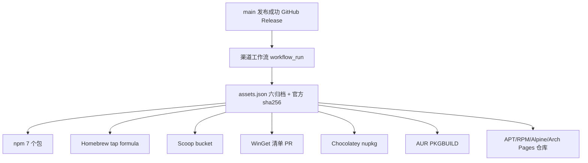

# 多渠道软件包发布

状态：参考；治理：现状文档。适用范围：Kenvoy CLI 二进制分发到 npm、Homebrew、APT、RPM、Alpine、Arch、WinGet、Chocolatey、Scoop。产品源包发布仍见 [Git 与发布操作](releasing.md)；本轮实施见 [0024](../changes/0024-package-channels.md)。

## 总体结构



渠道工作流为 [.github/workflows/channels.yml](../../.github/workflows/channels.yml)：由 `main 最新版本自动发布` 成功结束触发，也支持 `workflow_dispatch` 指定已发布版本补发。它只消费已存在的 GitHub Release 资产，不重新编译、不改动 crate 或 Release。每个渠道独立 job，单渠道失败不撤销已经完成的 Release；修复后重跑同一工作流即可，已存在的内容按各自规则跳过或幂等更新。

前置条件：版本 tag 已推送；Release 有六个 ZIP 且带 GitHub 官方 digest。缺任一归档时在 `prepare` 阶段失败，不进入各渠道。0.2.0 及更早的 Release 使用旧的三元组文件名，不在本工作流兼容范围内；渠道发布从采用 `kenvoy-{version}-{platform}-{arch}.zip` 的下一个版本开始。

## 资产与命名

`assets.json` 由 [assets.py](../../.github/scripts/channels/assets.py) 生成，固定六项：`windows/linux/macos × x86_64/ARM64`，文件名 `kenvoy-{version}-{platform}-{arch}.zip`，`sha256` 取 Release 资产 digest。所有渠道只引用这些官方归档，不各自重算二进制。

## npm

发布 7 个**无 scope** 包，避免依赖 npm 组织：

| 包 | 内容 |
|---|---|
| `kenvoy` | 主包：`bin` 为 JS shim，按 `process.platform/arch` 解析平台包，转发参数、stdio 与退出码 |
| `kenvoy-win32-x64`、`kenvoy-win32-arm64` | Windows 二进制 |
| `kenvoy-linux-x64`、`kenvoy-linux-arm64` | Linux musl 静态二进制 |
| `kenvoy-darwin-x64`、`kenvoy-darwin-arm64` | macOS 通用归档中的对应架构 |

主包通过 `optionalDependencies` 依赖六个平台包；平台包声明 `os`/`cpu`，内含真实 `bin/kenvoy(.exe)`。`npm publish --access public --provenance` 使用 `NPM_TOKEN`；已存在同版本时跳过，不覆盖。

安装：

```text
npm install -g kenvoy
kenvoy --version
```

## Homebrew

tap 仓库 `zerobiubiu/homebrew-tap`，formula 为二进制形式，按 `on_macos/on_linux` 与 `on_arm/on_intel` 选择 Release ZIP，`bin.install "kenvoy"`。不使用源码构建或 bottle 重建。

```text
brew tap zerobiubiu/tap
brew install kenvoy
```

## Scoop

bucket 仓库 `zerobiubiu/scoop-bucket`，清单 `bucket/kenvoy.json` 提供 64bit/arm64 的 URL、hash、`bin: kenvoy.exe`、`checkver`/`autoupdate`。

```text
scoop bucket add zerobiubiu https://github.com/zerobiubiu/scoop-bucket
scoop install kenvoy
```

## WinGet

生成 `manifests/k/Kenvoy/Kenvoy/<version>` 三份 YAML（version/installer/locale），InstallerType `zip` + `NestedInstallerType: portable`，x64 与 arm64 各一条。工作流用 `WINGET_TOKEN` fork 并提交 PR 到 `microsoft/winget-pkgs`；合并由上游审核，不由本仓库决定。

## Chocolatey

`kenvoy.nuspec` + `tools/chocolateyInstall.ps1`，安装脚本按 `PROCESSOR_ARCHITECTURE` 选择 x64/ARM64 归档、校验 checksum、解压到 tools 并 `Install-BinFile`。使用 Windows runner 的 `choco pack/push` 与 `CHOCOLATEY_API_KEY`。社区源有审核延迟，推送成功不等于立即可安装。

## AUR

生成 `kenvoy-bin` 的 `PKGBUILD` 与 `.SRCINFO`，`arch=(x86_64 aarch64)`，直接安装 Release 二进制。使用 `AUR_SSH_PRIVATE_KEY` 推送到 `ssh://aur@aur.archlinux.org/kenvoy-bin.git`。

**外部前置**：AUR 不接受纯 SSH 首次建仓，需要先在 AUR 网页提交一次空 `kenvoy-bin` 仓库；之后 CI 才能自动更新。

## APT / RPM / Alpine / Arch 仓库

托管在公共仓库 `zerobiubiu/kenvoy-packages` 的 `gh-pages`，通过 GitHub Pages 提供（`https://zerobiubiu.github.io/kenvoy-packages/`）。四个仓库共用一份站点，按版本累加，旧版本文件不删除。

| 仓库 | 路径 | 索引与签名 |
|---|---|---|
| APT | `/apt` | `dists/stable` + `pool/main/k/kenvoy`；`Packages.gz`、`Release`，GPG 清签 `InRelease` 与 `Release.gpg` |
| RPM | `/rpm` | `createrepo_c` 生成 `repodata`，`repomd.xml` GPG 分离签名 |
| Alpine | `/alpine` | `APKINDEX.tar.gz`，使用 APK RSA 密钥签名；公钥随站点发布 |
| Arch | `/arch` | `repo-add` 生成 `kenvoy.db.tar.gz`，GPG 签名 |

安装示意（以 `stable`/x86_64 为例，实际按发行版调整）：

```text
# Debian/Ubuntu
curl -fsSL https://zerobiubiu.github.io/kenvoy-packages/apt/key.asc | sudo gpg --dearmor -o /etc/apt/keyrings/kenvoy.gpg
echo "deb [signed-by=/etc/apt/keyrings/kenvoy.gpg] https://zerobiubiu.github.io/kenvoy-packages/apt stable main" | sudo tee /etc/apt/sources.list.d/kenvoy.list
sudo apt update && sudo apt install kenvoy

# Fedora/RHEL
sudo rpm --import https://zerobiubiu.github.io/kenvoy-packages/rpm/RPM-GPG-KEY-kenvoy
sudo dnf config-manager --add-repo https://zerobiubiu.github.io/kenvoy-packages/rpm/kenvoy.repo

# Alpine
wget -O /etc/apk/keys/kenvoy.rsa.pub https://zerobiubiu.github.io/kenvoy-packages/alpine/kenvoy.rsa.pub
echo "https://zerobiubiu.github.io/kenvoy-packages/alpine/v3.20/main" >> /etc/apk/repositories

# Arch
# /etc/pacman.conf: [kenvoy] Server = https://zerobiubiu.github.io/kenvoy-packages/arch/$arch
```

`kenvoy.repo`、`key.asc`、`RPM-GPG-KEY-kenvoy`、`kenvoy.rsa.pub` 由仓库发布脚本随索引生成。

## 所需仓库 Secret

| Secret | 用途 | 生成方式 |
|---|---|---|
| `NPM_TOKEN` | npm 发布 7 个包 | npm 账号 Automation token |
| `PACKAGES_TOKEN` | 推送 tap/bucket/Pages 仓库 | GitHub PAT（`repo`，对三个辅助仓库有写权限） |
| `WINGET_TOKEN` | fork 并 PR 到 microsoft/winget-pkgs | GitHub PAT（`public_repo`） |
| `CHOCOLATEY_API_KEY` | 推送 Chocolatey 包 | community.chocolatey.org API Key |
| `AUR_SSH_PRIVATE_KEY` | 推送 AUR | AUR 账号 SSH 私钥（OpenSSH 格式） |
| `GPG_PRIVATE_KEY` | APT/RPM/Arch 仓库签名 | 导出私钥后 base64 |
| `GPG_PASSPHRASE` | 上述密钥口令（无口令可留空） | — |
| `APK_SIGNING_KEY` | APK 包与索引签名 | RSA 私钥 PEM 后 base64 |

`prepare` 之后各 job 在缺 Secret 时明确失败并指出名称，不伪造成功。所有密钥只在对应 job 注入，不打印、不写入制品。

## 验证边界

本轮只做本地产物生成与静态检查，尚未运行 GitHub 上的渠道发布，也不代表各包管理器已完成审核（WinGet PR、Chocolatey 审核、AUR 首次建仓均为外部流程）。实际可用性以对应仓库/源的安装结果为证据，见 [0024](../changes/0024-package-channels.md) 的执行记录。
