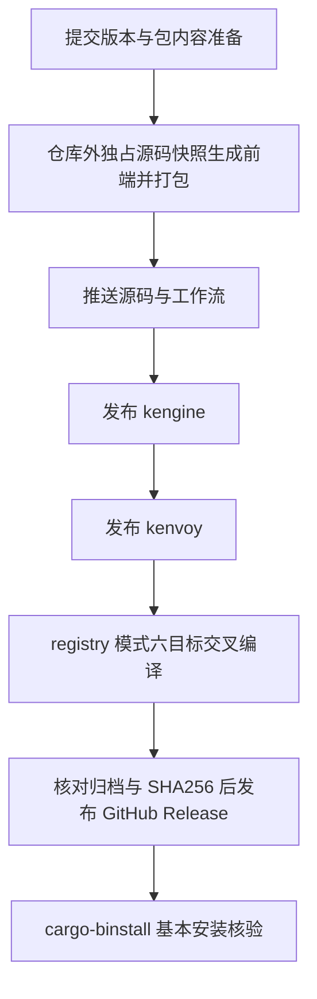

# crates.io 与预编译二进制发布

状态：参考；治理：现状文档。适用：KEngine Library 与 Kenvoy CLI；执行事实见[0.2.0 发布记录](../changes/0019-crates-and-binary-release.md)，版本概要见[版本日志](../changes/CHANGELOG.md)。

## 发布边界

Workspace 保留四成员，仅发布 `kengine` 和 `kenvoy`。`kenvoy-tests`、`xtask` 的 `publish = false` 不变。产品版本分别定义在各自 Cargo.toml，Kenvoy 的 KEngine 依赖同时声明本地 path 和 registry version；两个版本可以独立演进，不把应用 IR/数据库格式版本当成程序版本。

发布包必须独立构建：Kenvoy 的包白名单包含通用 `frontend/dist/index.html`、`assets`、框架源码/构建脚本/锁文件及 Rust 代码，不包含 node_modules、用户数据、凭据或工程运行缓存。构建脚本显式识别本地 Workspace 和独立包布局；独立包只依赖包内锁文件和实际锁定依赖信息，不寻找兄弟 Crate 或上层仓库文件。

## 发布顺序



每次发布确认版本、授权、干净提交、包内容和凭据。版本上传后不能覆盖；若客户端等待索引超时，先查询 registry，不能盲目重复上传。源码推送、crates.io 上传和 GitHub Release 是三个独立的对外操作，不把部分成功写成整次成功。

前端资产属于生成的发行输入，不提交进源码仓库。正式源包从已提交 Git SHA 的 `git archive` 快照组装：在仓库外独占目录重建前端，再运行 Cargo 打包/发布。包白名单均锚定包根，不能因 README/LICENSE 的同名匹配带入 node_modules；不以 `--allow-dirty` 或 `--no-verify` 代替受控输入和正常包编译。

## 交叉编译与归档

目标是 Windows MSVC、Linux musl、macOS 的 x86_64 与 aarch64。Linux/macOS 使用 Zig 和 cargo-zigbuild，替代 GCC；macOS 仍需要 Apple SDK。Windows MSVC 使用微软 SDK/交叉工具链，不使用 GCC，也不把 GNU 产物冒充 MSVC 目标。仅使用标准公开仓库 runner，不依赖付费大型 runner。

跨架构编译不代表运行测试。0.2.0 按用户要求不执行 cargo test、npm test 或浏览器测试；保留 Cargo 发布自带的编译校验、PE/ELF/Mach-O 架构检查、SHA256，以及兼容 host 上的基本版本/安装核验。不能执行的架构不声称已运行通过。

工作流定义为 [.github/workflows/distribution.yml](../../.github/workflows/distribution.yml)，输入精确 `version=0.2.0` 与 `mode=source|registry`。当前固定 Rust 1.98.0、Zig 0.17.0、cargo-zigbuild 0.24.0；cargo-zigbuild 从官方二进制 wheel 安装且不带 ziglang，避免重复安装 Zig。macOS 产物的最低系统版本为 13.0。

目标清单集中在 [.github/distribution-targets.json](../../.github/distribution-targets.json)。`platforms=all` 构建六目标；`platforms=windows` 只补打包 Windows 两目标，避免重跑已完成的 Linux/macOS 归档。Windows 固定在包含 Visual Studio 2022 的 windows-2022 runner，仍使用 SDK 10.0.26100.0 / 工具集 14.44；Windows 的 Cargo 编译步骤使用 PowerShell，保留开发者环境 PATH，避免 Git Bash 的同名 link.exe 抢占 MSVC 链接器。

```text
gh workflow run distribution.yml --ref main -f mode=source -f version=0.2.0
gh workflow run distribution.yml --ref main -f mode=registry -f version=0.2.0
```

分发文件名为 `kenvoy-{version}-{target}.zip`，归档根仅含 `kenvoy.exe` 或 `kenvoy`、README.md、LICENSE，旁附 `.sha256` 校验文件。`cargo xtask dist` 负责归档及机器架构检查，不管理用户项目数据。

工作流支持两种触发方式：

- **tag 推送（推荐）**：推送 `vX.Y.Z` 形式的版本 tag 自动触发六目标 source 构建；全部成功后自动创建对应 GitHub Release 并附六份 ZIP/SHA256。版本号从 tag 名派生，不用手动输入。crates.io 仍需手动发布，工作流不发布 crate、不创建 tag。
- **手动 dispatch**：按需指定 mode/version/platforms，只构建并上传 Actions artifacts（保留 14 天），不创建 Release。用于补打包特定平台（`platforms=windows`）或 registry 模式的最终分发核验。

普通分支推送不触发任何 CI/CD。

tag 推送必须**逐个执行**（`git push origin v0.3.0`，一次一个）。GitHub 官方规定一次推送超过三个 tag 时不生成任何 push 事件；且一次推送 2—3 个 tag 存在未修复的触发不可靠问题（actions/runner#3644）。禁止用 `git push --tags` 或 `git push --follow-tags` 批量推版本 tag；若批量推送后未触发，用手动 dispatch 补打包。

## 身份与安装

GitHub 与 crates.io 分别认证。GitHub CLI 使用本机现有登录；crates.io 在本机执行 `cargo login --registry crates-io`。不在聊天、源码、工作流或日志中传递 Token，不把 GitHub OAuth Token 冒充 registry Token。

发布成功后的用户命令：

```text
cargo add kengine@0.2.0
cargo install kenvoy --version 0.2.0 --locked
cargo binstall kenvoy --version 0.2.0
```

验收 cargo-binstall 时只允许项目自身 Release 元数据策略，禁用编译与第三方 QuickInstall 回退，防止“实际从源码构建”被误记为二进制分发成功。版本核验使用独占安装目录，不覆盖操作者已有程序。
