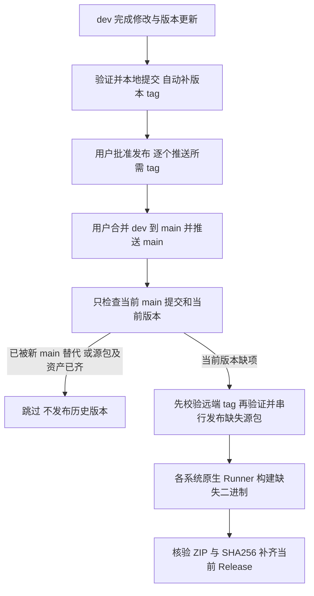

# Git 分支、版本标签与发布操作

状态：参考；治理：现状文档。适用：本 Workspace 的 Kenvoy CLI 与 KEngine，不是 kenvoy 项目的业务部署。执行规则见 [AGENTS.md](../../AGENTS.md)，本轮变更见 [0021](../changes/0021-dev-main-release-rules.md)；已发布 0.2.0 的历史证据见 [0019](../changes/0019-crates-and-binary-release.md)。

## 分支与授权

| 分支 | 用途 | 自动触发 |
|---|---|---|
| `dev` | 所有开发、验证与版本演进，常驻分支 | 推送和 tag 均不触发 CI/CD；可显式手动打包 |
| `main` | 用户决定发布后合入的最新版本代码 | 推送触发当前版本发布检测；无缺项则跳过 |

不再创建 `dev.MAJOR.MINOR.PATCH` 分支。PATCH 与其他版本一样在 dev 完成，经用户授权合并 main 后发布；不存在从开发分支紧急发布的旁路。

一波完整逻辑修改验证通过后自动本地提交，使用中文信息。只暂存本次授权文件，不夹带用户改动、凭据、依赖目录、构建产物或业务数据。自动提交和自动本地打 tag **不授权推送、切分支、合并、变基或改写历史**；这些操作仍须用户明确要求。

工作流文件在 dev/main 共享，防止普通合并删除 main 的发布配置。发布入口、共享发布实现及实际写操作都检查 main；文件出现在 dev 不表示 dev 可以发布。

## 根节点与版本标签

共同根为 `7d3b5c2860d6e3c64948612a53d0df74ddf47883`，原始提交消息、文件内容与 SHA 不改。其真实产品版本标签为 `v0.1.0`，与[已发布 0.1.0 的来源记录](https://docs.rs/crate/kenvoy/0.1.0/source/.cargo_vcs_info.json)一致。人工初始化标签 `v0.0.0` 已退役并删除，不再凭根节点身份额外生成它；标签只来自提交中真实声明的版本。

- 产品版本来自各产品 `Cargo.toml`，不是 kenvoy 项目的配置版本或 IR 版本；Kenvoy CLI 的版本用于仓库 `vMAJOR.MINOR.PATCH` 标签与 Release 名称。
- KEngine 保留自身 manifest 版本；Kenvoy 的依赖约束和 Cargo.lock 必须同步。仅工作流、文档、工程工具变更不机械递增产品版本。
- dev 中已提交的 Kenvoy CLI 版本每次变化时，立即创建对应附注标签。缺失的历史标签补到该版本首次出现的提交，不挂到补齐时的 HEAD；根的真实版本同样纳入。工作区、暂存区尚未提交的版本不参与判断，同版本普通提交不重打标签；既有合法发布标签保留其原目标。
- 既有合法标签保持原目标；不会自动移动、覆盖、删除或推送。轻量标签、指错版本、目标不在 dev 历史等冲突会阻断维护，不能强行改写。
- **补标签不等于补发布**：缺失历史标签可补，历史 crate/Release 不自动补发。

### 本地自动标签

[version-tags 命令](../../xtask/src/commands/version_tags/)使用 Git 对象与 TOML 解析，默认只读预览；`--apply` 只在 dev 的完整非浅仓库执行引用事务。Git 需要 2.36 或更新版本，并配置有效身份。

```text
cargo xtask version-tags
cargo xtask version-tags --apply
```

可写任务开始/收尾均按需核对补齐；[post-commit](../../.githooks/post-commit)、[post-checkout](../../.githooks/post-checkout)、[post-merge](../../.githooks/post-merge)、[pre-push](../../.githooks/pre-push) 共用[标签维护入口](../../.githooks/maintain-version-tags)，在 dev 提交后、切换回 dev、合并到 dev 后及获准推送前自动执行 `version-tags --apply`。其他分支、分离 HEAD 不自动写标签；只读任务不写引用。启用仅影响本仓库，存在自定义钩子时先协调，不能覆盖用户配置：

```text
git config --local --get core.hooksPath
git config --local core.hooksPath .githooks
```

克隆仓库后需单独启用该本地配置，先准备 xtask 的 Rust 依赖缓存。钩子采用 `--offline --locked`：提交/切换/合并后的失败会说明 Git 操作已完成，不伪称回滚；推送前维护失败则阻止本次推送。修复原因后按上方命令补齐标签。钩子不联网推送，也不扩大用户给定的 refspec；获准推送时把保留的本地标签逐个显式推送到 GitHub，不遗漏先前补齐项。

## 正式发布顺序



必须**先推版本 tag，再合并/推送 main**，例如 `git push origin v0.3.1`；逐个推送仅限本次获授权的标签，不用 `--tags` / `--follow-tags` 批量上传未核对版本。tag 推送本身不会触发本仓库发布，因此此规则不是依赖 tag 事件数量限制。

CI 在任何 crate 上传前检查远端标签存在、与本地精确提交一致、已合入 main、版本相符。若有新源包待发布，main 源码树必须与版本标签一致；标签后继续修改源码应完成新版本并打新标签，不能让旧标签描述另一份代码。缺标签、标签冲突、源代码漂移都在上传前失败；工作流不自动创建或移动远端 tag。

自动与手动兜底共用并发组，写入前再次核对远端 main。旧运行被新 main 取代时不继续发布；无缺项的当前版本不构建、不上传，也不扫描其他 tag 的发布状态。

## 工作流职责

| 文件 | 触发与职责 |
|---|---|
| [release.yml](../../.github/workflows/release.yml) | 仅 `push main` 自动进入当前版本发布流程 |
| [patch-release.yml](../../.github/workflows/patch-release.yml) | main 手动兜底，必须 `confirm=yes`；无任意版本输入，不再表示 PATCH 开发分支发布 |
| [release-one-version.yml](../../.github/workflows/release-one-version.yml) | 两入口共用：只读规划 → 缺失源包 → 缺失二进制 → 当前 Release；拒绝非 main |
| [manual-package.yml](../../.github/workflows/manual-package.yml) | 任意选定分支手动打一个系统 × 一个架构，只上传 artifact，不发布 |

旧 `distribution.yml` 的历史扫描链路已删除，不保留另一套发布入口。CI 的 HTTP/状态协调位于 [.github/scripts](../../.github/scripts/)，使用标准库 Python，轻量检测不先编译产品；本地 Git/归档工程能力继续由 Rust xtask 提供。

### crates.io 与失败恢复

只有 `kengine` 和 `kenvoy` 对外发布，`kenvoy-tests`、`xtask` 保持 `publish=false`。先查询两个包各自的精确版本：仅 404 表示缺失；鉴权、限流或网络错误不能当作未发布。

新源包从 main 精确 Git SHA 的 `git archive` 创建仓库外独占快照，在快照生成 Kenvoy 内置前端并执行 Cargo dry-run/编译校验，再按 KEngine → Kenvoy CLI 上传缺失项。不使用 `--allow-dirty` 或 `--no-verify`；根 LICENSE 通过 workspace license-file 进入每个发布包。

上传是不可逆操作；不覆盖既有版本，不盲目重试上传写请求。KEngine 成功、Kenvoy 失败时，手动兜底只处理仍缺失的当前版本步骤。已发布源包补二进制时，从实际 registry 源包核对官方 SHA256 后构建，使用包内前端，不拿后来修改的工作区冒充原发布源码。

GitHub Release 先以草稿收集缺失资产，齐全并验证后公开；标题固定为 `Kenvoy <version>`。既有 ZIP/侧车不使用 `--clobber`：已有 ZIP 缺侧车时按原 ZIP 计算校验值，不重新构建后替换；发现既有校验冲突即停，留给人工核查。历史已发布版本按其发布包的下载元数据识别资产，不因新命名规则重命名旧文件。

### 凭据与 GitHub 权限

`CARGO_TOKEN` 是仓库 Secret，只交给需要上传源包的步骤；发布器向实际 Cargo 上传子进程注入 `CARGO_REGISTRY_TOKEN`，供默认 crates.io 读取。不能用命名仓库的 `CARGO_REGISTRIES_CRATES_IO_TOKEN` 替代；编译、前端和 dry-run 环境继续剥离凭据。GitHub 使用 `github.token`，两个认证域分开，GitHub Token 不发送给 crates.io，也不读取或输出操作者本地 Cargo 凭据。修复与真实 Cargo 回归见 [0034](../changes/0034-cargo-auth-and-044-release.md)。

[GitHub 官方可复用工作流规则](https://docs.github.com/en/actions/how-tos/reuse-automations/reuse-workflows)允许命名 Secret 传递和 `secrets: inherit`，但权限在调用链中只能保持或降低。两个入口的调用 job 明确授予 `contents: write`，被调用流程的构建/检查 job 保持只读，仅 Release job 使用写权限。

旧说明中“本仓库 reusable Secret 不可用”“被调用 job 不能声明 write”的结论没有充分证据，已撤销；不能用这些说法作为绕过权限配置的规则。表达式空字符串使用 `''`，Windows Cargo 编译仍用 PowerShell，避免 Git Bash 同名 `link.exe` 抢占 MSVC。

## 平台与单目标打包

目标配置集中于 [.github/distribution-targets.json](../../.github/distribution-targets.json)，手动和正式发布共用[单目标 action](../../.github/actions/package/action.yml)。Windows 目标在 Windows runner 上使用 MSVC，Linux 在 Ubuntu runner，macOS 在 macOS runner；同系统内仍可交叉架构，不把 Linux runner 用于统一构建所有系统。

正式 Release 覆盖 Linux、Windows、macOS 的 x86_64 与 ARM64。新归档名为 `kenvoy-{version}-{platform}-{arch}.zip`，platform 为 `windows/linux/macos`，arch 为 `x86_64/ARM64`，附同名 `.sha256`；包内可执行文件仍为 `kenvoy` 或 `kenvoy.exe`。Rust target triple 中的 `aarch64` 不改名。binstall 元数据与归档名称同步。

手动打包例子（仅在获准触发远端任务后执行）：

```text
gh workflow run manual-package.yml --ref dev -f platform=windows -f arch=ARM64
```

它只选择一个目标，上传 ZIP 与侧车为 Actions artifact，保留 14 天，不需要发布 Token、不创建 tag、不上传 crates.io、不创建 Release。

main 手动发布兜底：

```text
gh workflow run patch-release.yml --ref main -f confirm=yes
```

只检查当时 main 当前版本；不得指定 dev、历史版本或用兜底发布未合并代码。

## 验证边界

工作流语法通过不等于发布完成；交叉编译通过不等于所有架构运行通过。最低充分核验包括：真实临时 Git 标签行为、只读发布计划（非 main 拒绝、已发布跳过、缺 tag 阻断、当前 PATCH 接受）、平台单选、实际 ZIP/侧车与包内 LICENSE、工作流静态检查。实际对外运行需另行获准推送后观察 Actions 和 Release 结果。

cargo-binstall 安装核验使用独占安装目录，限制为 crate-meta-data 策略，禁用编译及 QuickInstall 回退；既有 0.2.0 安装与发布证据保留在 0019，不冒充本轮重新发布。
