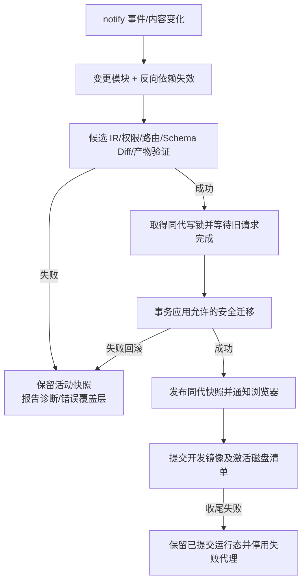

# 应用运行时、前端与生命周期设计

状态：现行实现；build/run、notify、开发镜像及 HTTP/WebSocket 代理已接入，正式 HMR、错误恢复、生产运行与真实 Ctrl+C 已通过[生命周期验收](verification/0011-cli-lifecycle.md)。

## 统一状态

HttpRuntime 持有 Application IR、generation、client 目录与不可变 JavaScript 模块包，使用 RwLock 保证资源请求使用同代模型；Database 和 Auth 通过受控句柄访问专属连接线程。页面/路由/权限来自该 IR，客户端描述按身份显式投影，不在请求内解析 TSX、构建 React 或重新初始化数据库。构建清单独立封存、校验并激活，不把磁盘清单替换误认为数据库事务的一部分。

可变运行资源由明确所有者持有：HTTP 生命周期持有监听与退出信号；数据库线程持有连接；JS worker 持有 Runtime/Context；开发监督器持有 watcher、构建进程与刷新连接。共享的是不可变快照和有界消息通道，不是全局可变业务状态。

## 项目配置

配置文件为 kenvoy.toml，按项目根解析入口、数据库和输出路径。默认入口 src/app.tsx、监听 127.0.0.1:3000、数据库 data/app.sqlite、构建 dist，React/CSR/SQLite 为首版支持实现。端口、provider、framework、render、javascript 等字段严格类型校验；未知字段或不支持值立即报错，解析错误不能退回默认配置继续启动。

配置分 project、application、server、database、frontend、runtime、build；敏感值通过运行环境或受控输入提供，不能进入客户端描述和 manifest。生产与开发使用相同项目根和数据库路径规则；禁止用当前进程临时目录替代项目根。

输出目录在任何写入前解析绝对路径并检查链接/重解析点：不能是项目根、源码根、数据库目录或它们的危险祖先，不能与持久化目录重叠。数据库不得置于 dist。当前 out_dir 必须是项目内独立目录，外部路径明确拒绝；不以字符串前缀判断目录包含关系。

## CLI 设计

| 命令 | 责任 | 关键失败策略 |
|---|---|---|
| create（已实现） | 准备项目配置、入口、数据目录及 README/ignore | 目标已有内容则拒绝覆盖；不自动装包 |
| check | 语法、模块、DSL、路由、字段、环境边界检查 | 输出结构化诊断；非零退出；不迁移 |
| inspect | 展示 Generic/Application IR 或指定资源、注册路由、策略 | 无 Session 不声称“当前用户有管理权限” |
| build | 完整分析、客户端打包、server 转换、产物校验、manifest | 不连接业务数据库；不导出业务数据 |
| dev | 构建候选、SQLite/Auth/HTTP、notify、开发状态和可选 Vite 镜像 | 错误保留最后有效模型；恢复活动配置清理错误但不重复迁移 |
| run | 新鲜度/兼容性检查、必要时构建、数据库与 HTTP | 不要求先 build；无 watcher/HMR |
| migrate（已实现） | 默认 status、apply、history | 明确展示 diff；破坏性计划未确认不执行 |

已实现 `kenvoy admin init --username <name>` 与 `admin add-user --username <name> --role user|admin`。本机终端隐藏密码并二次确认，自动化必须显式 `--password-stdin`；不提供密码命令参数，不写凭据日志。账号创建使用事务和已有管理员检查，重复初始化不能覆盖已有账号。详细输入限制见 [安全设计](security-design.md)。

基础 DSL 项目使用随 CLI 内嵌的预构建 React 原生 CSS Runtime，无需 Node 开发服务器。自定义 UI 使用锁定前端工具链及独立框架缓存；用户依赖缺失时需显式 --install-deps，不静默改写 package.json。缓存命中时不重新安装全部依赖。CLI 仍是 Rust 原生宿主，HTTP、SQLite 和业务解释均不交给 Node。

## HTTP 和 Resource Runtime

Axum/Tokio 管理单个公开业务端口；Tower 中间件处理请求限制和安全头，tower-http ServeFile 服务真实文件。当前提供 `/api/{resource}`、`/api/{resource}/{id}`、`/api/actions/{name}`、`/_kenvoy/session|login|logout|application`，页面与资源来自已检查的 IR，不能把任意路径映射到数据库表。Action 先验证 Execute，再调用受限 QuickJS，完整契约见 [JavaScript Runtime](javascript-runtime.md)。

Resource Runtime 提供 create/get/list/update/delete、字段规则、默认值和授权。表名/列名只能来自验证 IR，标识符采用集中安全引用；用户输入只用 SQL 参数。查询字段、排序字段、方向、过滤操作均来自白名单，拒绝未知/重复参数。

列表默认每页 20、最大 100 已实现；页码须为正整数，排序包含唯一 id 保证稳定。HTTP 查询支持 page、page_size、search、sort、direction=asc|desc，以及 filter_字段名=JSON标量的等值过滤；最多十六个过滤条件。数据库内部还支持其他受控比较操作。搜索最多 256 个 Unicode 字符，LIKE 特殊字符按字面量转义，搜索和 Contains 拒绝 NUL；查询串最多 8192 字节。更新只修改明确允许字段；系统 id、时间和角色字段禁止批量赋值。

API 返回真实 SQLite 数据；公开 create 返回其新建记录的公开字段投影。错误按验证、认证、权限、不存在、冲突、过载和内部故障区分 HTTP 状态；响应包含稳定错误类别和请求关联标识，内部栈、SQL、路径和密码不对外暴露。数据库唯一冲突转换为业务冲突，不能直接返回驱动错误。

`/api` 和认证 API 的 404/405 不回退 HTML。只为已注册客户端页面返回真实 index.html；缺少构建产物时明确 404。静态根仅为显式 client 目录，文件规范化后仍须在根内；绝不暴露项目根、整个 dist、modules/server、SQLite 或配置。有产物时匿名已注册管理导航 303 跳转登录，普通用户仍 403；API 始终返回 JSON 401/403。

## 认证、授权与请求安全

初版账号角色已区分匿名、普通用户和管理员。密码使用独立随机盐的 Argon2id；固定参数、摘要和 Session 容量均已验证。登录失败统一提示，密码任务并发为 2，用户名/IP 限流状态最多 4096 键；没有默认管理员密码。具体参数及剩余威胁边界见 [安全设计](security-design.md)，尚未完成生产负载基准测试。

Session 使用操作系统随机源生成不透明 token，服务端存 token 摘要、用户和到期时间；浏览器只持有 HttpOnly Cookie。采用 SameSite 策略、限定 Path，HTTPS public_origin 设置 Secure；本地 loopback HTTP 可直接开发。HTTPS 终止代理必须保留配置匹配的 Host，当前没有 Forwarded 信任配置。认证成功和退出均轮换 Session；新建时有界清理过期项，没有独立的定时清理任务。

所有管理 API 先认证，再按 Resource/操作策略授权。普通登录用户不隐含管理员角色；管理页面 shell 可以显示登录界面，但未认证不能获取管理数据。前端按钮隐藏只是展示，服务端每次检查权限。

写操作已使用 Origin/同源校验与 HMAC-SHA256 CSRF token；Cookie 的 SameSite 不作为唯一防线。公开表单先获取匿名提交上下文，token 不提升资源权限。请求体最大 1 MiB、接收期限 30 秒；任意层 JSON 重复键、重复解码查询参数和重复安全头被拒绝。限流使用有界固定窗口，当前额度硬性固定且有回归测试，配置化待后续实现。

React 默认转义文本；不允许从描述注入原始 HTML、危险 URL、脚本文本或任意 eval。自定义 UI 是可信项目代码，若开放危险 HTML 必须明确由开发者负责并进行专门审查；首版 Runtime 不提供该 DSL 能力。日志不记录密码、Cookie、token、表单内容或完整数据库记录。

## 通用 React Runtime 与 Admin

客户端接收版本化 ClientApplicationDescription：页面 ID、route/title、组件树、字段约束、资源/动作 ID、模块注册 ID 与展示权限。注册表选择 text/number/boolean/date/select/form/table 等通用组件，自定义 UI 以组件类型注册，并由 React 渲染以保留 Hooks 语义。事件引用通过明确 ID 与模块桥接，不把函数序列化成 JSON。

React Router Declarative Mode 负责客户端匹配，原生 CSS tokens 统一布局。表单有加载、字段错误、提交中、成功与失败状态；请求完成前防重复提交，服务端始终重验。number/日期/空值转换与 Resource 规则一致，不信任浏览器原生校验足够完备。

Admin 复用相同 Resource IR 和 API，提供左侧资源导航、顶部栏、列表、搜索、分页、排序、详情、新增、编辑、删除确认、通知、错误/加载/空状态。删除确认展示具体记录，权限在服务端执行。未认证先登录；登录成功再加载授权资源，不能将受保护数据内嵌在公开 shell。

基础 DSL 使用框架内置预构建资产；自定义组件用独立 Client 注册入口打包，不能直接打包完整 app.tsx 而顺带引入 action 的 server 实现。用户 UI、Runtime 和第三方 React 组件库 必须共享兼容的单份 React/React DOM。样式与第三方包由实际构建器处理，不能用静态 HTML 假装 React 应用。

## JavaScript Runtime

Kenvoy 管理 TS 去类型、ESM 模块准备、action 注册及 rquickjs 执行；KEngine 只提供语言分析与引用。首版只运行可信项目的 JSON 兼容纯函数和简单异步函数，不兼容完整 Node/Bun API。

采用有界任务队列和受控 worker，Runtime/Context 不跨异步请求无约束并发。模块解析器只允许已构建 server/shared 白名单，规范化后检查根目录，拒绝任意文件路径、node:、本地动态库及未知动态导入。默认不注入 std/os、网络、文件、环境变量或数据库连接。

每次调用使用新 Runtime/Context，默认 1 秒总期限、32 MiB 内存、512 KiB 栈及 32 项队列。CPU/无限微任务通过引擎 interrupt 终止，Promise 同时受宿主超时/取消控制；已在独立进程实际验证死循环、微任务循环、2 MiB OOM 及随后正常调用恢复。JSON 深度、节点数、大小和安全整数均检查。记录 action ID、耗时与脱敏结果，不输出调用参数。

服务端函数以 ID 通过权限校验调用；异常不泄漏源码或宿主路径。未来 Host API 的 ServerContext 仅暴露受限资源操作，复用 Resource 授权与验证，不暴露 rusqlite Connection 或 Rust 指针。文件/网络/数据库 Host API 不在首版纯计算闭环中开放。

对不可信第三方代码，必须使用独立进程或更强隔离后才允许执行；同进程 QuickJS 限额不等于 OS 沙箱。独立进程可由同一 kenvoy executable 的内部 worker 模式承担，不增加独立产品 Crate；该能力未实现前拒绝不可信执行。

## dev 更新与失败恢复

notify 回调只唤醒容量 1 的协调队列，180ms 去抖后比较内容指纹。KEngine AnalysisSession 重用未变化模块；构建候选经过 DSL、边界、服务端转换、前端构建、源码/资产指纹复核后封存。安全迁移与运行态发布由 HttpRuntime.publish_prepared 在同一写锁和被跟踪任务中完成；数据库成功后同步替换 IR/generation/assets/JS，没有新的可失败 await。调用者取消不打断已接受迁移，迁移失败不发布新状态。

监听项目内 TSX/TS/JS、mts/cts、CSS、配置和已支持静态资产，忽略独立数据/输出目录以及 .git/target/node_modules/.kenvoy/.env。事件以内容 hash 合并；当前使用 RecommendedWatcher，没有自动 PollWatcher 回退。源码、数据及输出必须彼此独立，不能把数据库直接配置在项目根。数据库路径、输出目录、host/port/public_origin 改动要求重启，其余合法配置按候选重新分析。

标题/布局更新投影，普通 UI/CSS 交给经实测的开发适配；UI 修改不重新初始化 SQLite。Schema 新字段先预览并判定安全；删除、改类型和无法证明安全的约束变化阻止激活，不自动破坏旧状态。语法错误期间继续服务最后有效快照，修复后重试分析，不迁移、不重建数据库。

所有可失败编译/打包先完成，再进入数据库迁移屏障；旧代请求有界排空，迁移和 Schema 版本记录同事务。新写请求在发布前暂停或返回可重试状态，不能用旧字段规则写新 Schema。前端提交携带代次以识别过期表单，必要时返回冲突并要求刷新。

数据库提交后崩溃或切换异常不能宣称回滚。协调器在提交成功后更新自身快照；Vite 镜像更新失败时停用代理，回到已验证静态产物，并报告需要重载。清单激活失败明确提示运行态已更新、收尾失败。重启通过产物完整性和实际 Schema 校验处理差异；没有承诺跨 SQLite 与文件系统的两阶段事务，完整故障恢复仍需继续注入验证。

基础 DSL 不启动 Vite。自定义客户端由 Vite/React 插件读取已校验镜像，原始用户源码不会被直接监听；候选提交后 Rust 通过私有 stdin 控制更新。普通 UI/CSS 使用 HMR，结构变化允许完整重载。正式 Kenvoy 浏览器已验证组件、CSS、错误保存及修复期间保持 Hooks 计数；不保证混合导出和结构变更均保留状态。

HTTP 开发状态仅在 dev 开放：`/_kenvoy/development` 返回 revision/generation/state/error?/reload。revision 随状态变化递增，generation 只在有效发布时变化。前端首次轮询建立基线，之后按 ready/reload 或新 generation 刷新；error 保留有效界面。首导航在 building 期间最多等待 10 秒，等待不持有模型读锁；超时返回 503 与 Retry-After:1，完成后按新模型重新鉴权，不返回混合代际入口。

Vite 仅监听随机回环端口；Rust 固定目标代理 `/_kenvoy/vite/*`，注入内部密钥，禁止 Cookie/Authorization/CSRF 转发，拒绝重定向及未注册页面的 HTML。WebSocket 要求同源 Origin、vite-hmr 协议和限流；限制连接、消息、缓冲及关闭时间。React preamble 外置为同源模块，CSP 不放开 inline script。真实回环代理、安全边界、浏览器 HMR 和关闭均已验证。

## build 与 run

产物保存为 dist/manifest.json 和 dist/versions/构建ID/，每个版本含 application.ir、client/index.html/assets 与 modules/server.json。manifest 记录格式、框架版本与指纹、源/配置/锁文件输入指纹、依赖版本、每文件大小及 SHA-256。宿主源码位置转换为相对路径；浏览器描述不包含这些位置。页面/API 来自 Application IR，不生成重复业务 Controller 或独立页面源码。

构建使用 OS 文件锁与独占 staging，校验后只追加版本目录，再通过临时文件及 rename 激活清单；不清空活动产物、不清理业务数据。已有同 ID 文件内容不一致则拒绝覆盖，外来输出目录也拒绝接管。单文件最多 32 MiB、总计 256 MiB、最多 10000 文件；拒绝路径链接、越根和大小写别名冲突。旧版本不自动回收。

源码存在时，run 校验输入指纹及产物完整性，缺失/过期才构建；构建失败不静默运行旧产物。无需事先 build。用户依赖缺失须显式 --install-deps，不能隐式补装或修改其声明。

已接入只有产物的部署：配置、完整 manifest、客户端/server 产物和独立 data 目录足够启动，不强制源码存在。校验格式/Runtime 兼容性、路径、哈希、依赖和 Schema 状态；不兼容或缺损报错，不在请求中解析源码。生产不启动 watcher、开发服务器或 HMR。

## 关闭与日志

Ctrl+C 信号先通知开发协调器停止，Axum 开始优雅退出前取消并等待开发 WebSocket；HTTP 完成后等待已接受发布任务。宿主随后回收 watcher/Vite、关闭 JavaScript worker，再关闭 SQLite 线程；启动失败同样走已创建资源的清理。基础与自定义组件 CLI 的真实 Ctrl+C、端口/WS 关闭和重启持久化均已验证；构建中途退出与断电不在本轮信号场景内。已接受写入结果不明不能声称未执行。

tracing 按 CLI、Compiler、Runtime、Database、HTTP、JavaScript 分类；开发可读、生产可选结构化。错误链保留上下文但脱敏。缓存、Session 清理、限流状态、刷新连接、后台任务均设置上限和释放途径。

相关决策：[ADR 0004](adr/0004-kenvoy-application-interpreter.md)、[0006](adr/0006-react-csr-runtime.md)、[0007](adr/0007-rust-http-runtime.md)、[0008](adr/0008-javascript-execution.md)。技术来源和实际验证边界见 [技术栈](technology-stack.md)。
